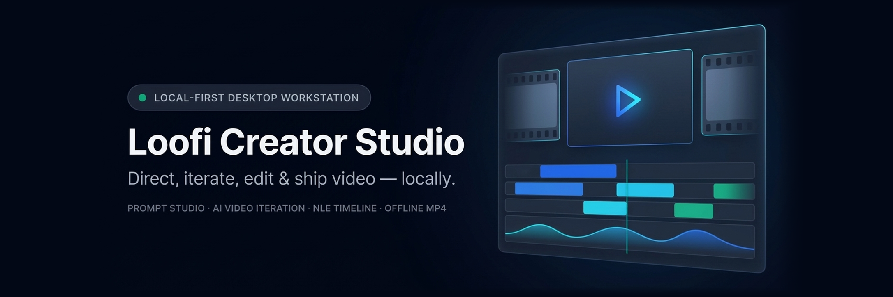
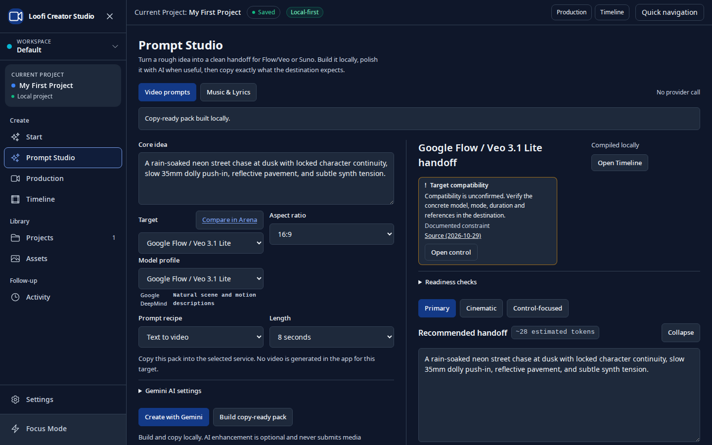
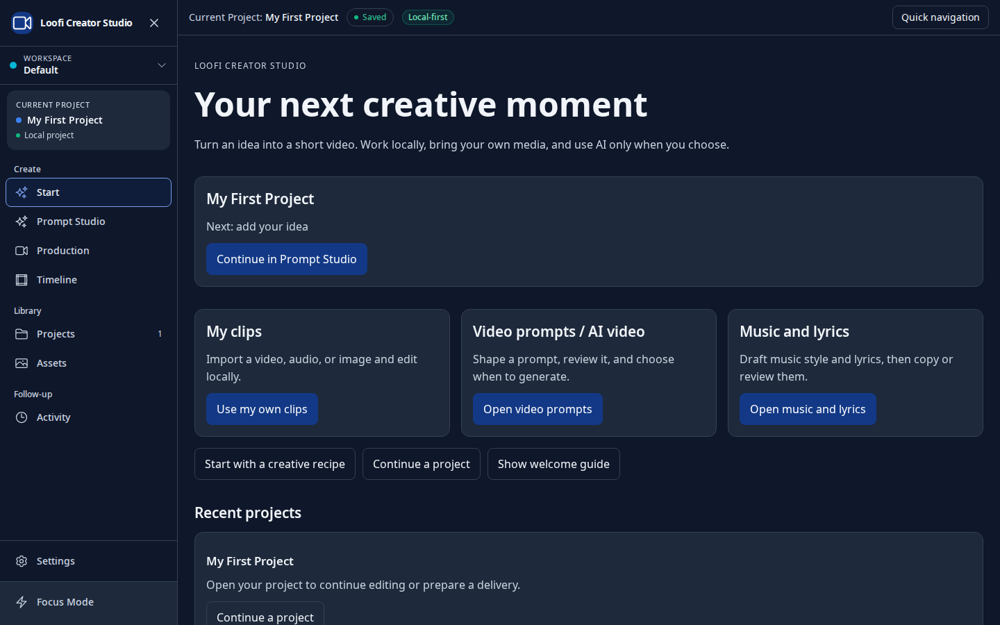
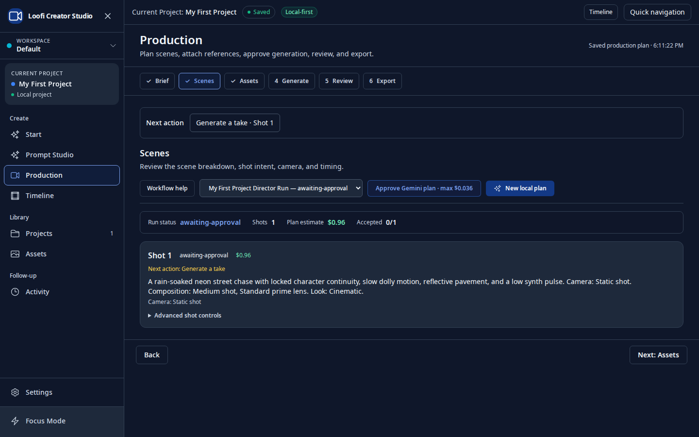
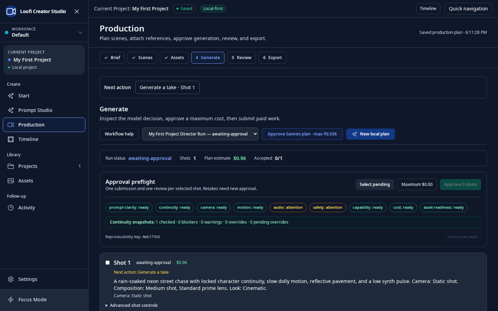
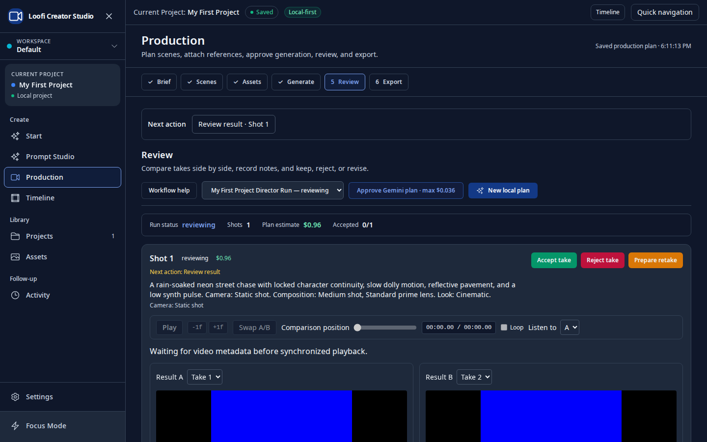

<p align="center">
  <a href="https://github.com/loofiboss-bit/Loofi-Veo-prompt-generator/releases/tag/v23.0.0">
    
  </a>
</p>

<h1 align="center">Loofi Creator Studio</h1>

<p align="center">
  <strong>Edit your own clips into verified MP4 video offline. Craft multi-model video prompts, iterate AI takes, and write Suno lyrics — in one local-first desktop workstation.</strong>
</p>

<p align="center">
  <a href="#install-v2300"><strong>Download v23.0.0</strong></a> ·
  <a href="#see-it-in-action"><strong>See it in action</strong></a> ·
  <a href="docs/wiki/Quick-Start.md"><strong>Quick start</strong></a> ·
  <a href="docs/wiki/Home.md"><strong>Explore the wiki</strong></a> ·
  <a href="ROADMAP.md"><strong>Roadmap</strong></a> ·
  <a href="https://github.com/loofiboss-bit/Loofi-Veo-prompt-generator/issues">Report an issue</a>
</p>

<p align="center">
  <a href="https://github.com/loofiboss-bit/Loofi-Veo-prompt-generator/releases/latest"></a>
  <a href="https://github.com/loofiboss-bit/Loofi-Veo-prompt-generator/actions/workflows/validate.yml"></a>
  <a href="#install-v2300"></a>
  <a href="LICENSE"></a>
  <a href="https://github.com/loofiboss-bit/Loofi-Veo-prompt-generator/stargazers"></a>
  <a href="https://github.com/loofiboss-bit/Loofi-Veo-prompt-generator/releases"></a>
</p>

---

## Why Loofi Creator Studio?

Most AI video tools scatter your work across browser tabs, overwrite your manual tweaks, and hide real costs until after generation. **Loofi Creator Studio** keeps your project, media, prompt variants, and timeline cuts in a single **local-first** desktop workspace—with zero accounts or API keys required for local creation.

<table>
  <tr>
    <td width="50%" valign="top">
      <h3>🎬 Offline Video Editing & Verified Delivery</h3>
      Import your own video, audio, and images into a multi-track timeline. Sync SRT captions or transcribe locally with Whisper, apply silence-cut trimming and EBU R128 loudness normalization, and export verified H.264/AAC MP4s and publication ZIP packages—completely offline.
    </td>
    <td width="50%" valign="top">
      <h3>✨ Prompt Studio & 7-Target Model Arena</h3>
      Compile any brief locally into three editable variants (<strong>Primary</strong>, <strong>Cinematic</strong>, <strong>Control-focused</strong>), compare packages across <strong>seven active video models</strong> in Arena, or craft section-locked <strong>Suno v6</strong> lyrics packs—plus optional 1-request Gemini scene expansion with per-field AI protection.
    </td>
  </tr>
  <tr>
    <td width="50%" valign="top">
      <h3>🔁 AI Video Iteration & Version Lineage</h3>
      Refine clips via multi-turn instructions with <strong>Gemini Omni 1.2 Flash</strong> (3–15s) and keep non-destructive <code>v1 → v2 → v3</code> lineage trees inside SQLite WAL project documents and portable <code>.loofi-project</code> archives, complete with side-by-side A/B review.
    </td>
    <td width="50%" valign="top">
      <h3>🔒 Local-First Safety & Cost Control</h3>
      Paid provider calls are fail-closed with explicit maximum-charge approval ceilings, OS-vault key storage, and zero silent model swaps. Available in six full languages (<code>en</code>, <code>sv</code>, <code>es</code>, <code>fr</code>, <code>ja</code>, <code>ar</code>) with keyboard-first shortcuts.
    </td>
  </tr>
</table>

---

## See it in action

<p align="center">
  
  <br />
  <sub><strong>Prompt Studio (v23.0.0)</strong> — Unified Workspace Context Rail, local 3-variant compilation, readiness checks, <code>Ctrl/Cmd+Enter</code> build, and 1-click <strong>Open Timeline</strong> with zero provider keys.</sub>
</p>

|                                             Start Workspace                                             |                                 Production Scene Planning                                  |
| :-----------------------------------------------------------------------------------------------------: | :----------------------------------------------------------------------------------------: |
|  |  |
|         **Start Hub** — Jump straight to your clips, video prompts, music, or recent projects.          | **Production Scenes** — Plan shots, camera intent, and continuity before spending credits. |

|                              Cost-Gated Approval Preflight                               |                           Side-by-Side A/B Take Review                           |
| :--------------------------------------------------------------------------------------: | :------------------------------------------------------------------------------: |
|           |                  |
| **Approval Preflight** — Exact cost ceilings and readiness gates before paid submission. | **A/B Review & Diagnostics** — Frame-stepped comparison and local health checks. |

Browse all [11 deterministic v23.0.0 screenshots](docs/wiki/Screenshots.md) and regeneration instructions (`npm run screenshots`).

---

## Install v23.0.0

**Fedora Linux (Fedora 44 & Fedora 45 x86_64 — KDE / Wayland)** is the primary supported desktop platform. Download any GitHub release artifact and verify it against [`SHA256SUMS.txt`](https://github.com/loofiboss-bit/Loofi-Veo-prompt-generator/releases/tag/v23.0.0) before installing.

### Fedora COPR (Recommended)

```bash
sudo dnf copr enable loofitheboss/loofi-creator-studio
sudo dnf install veo-prompt-generator
```

Already installed from COPR? Upgrade cleanly to `23.0.0`:

```bash
sudo dnf clean all && sudo dnf upgrade veo-prompt-generator
```

The [COPR project](https://copr.fedorainfracloud.org/coprs/loofitheboss/loofi-creator-studio/) repackages the qualified x86_64 RPM with clean Fedora runtime dependencies (`gtk3`, `nss`, `libsecret`, `at-spi2-core`, `libXScrnSaver`).

### Direct GitHub Packages

<table>
  <tr>
    <td width="50%" valign="top">
      <strong>Fedora RPM</strong> (<code>x86_64</code>)<br /><br />

```bash
sudo dnf install ./Loofi-Flow-Veo-Studio-23.0.0-linux-x86_64.rpm
```

</td>
    <td width="50%" valign="top">
      <strong>Linux AppImage</strong> (<code>x86_64</code>)<br /><br />

```bash
chmod +x Loofi-Flow-Veo-Studio-23.0.0-linux-x86_64.AppImage
./Loofi-Flow-Veo-Studio-23.0.0-linux-x86_64.AppImage
```

</td>
  </tr>
</table>

<details>
<summary><strong>Windows x64 (Optional / Manual Build Only)</strong></summary>

Windows binaries are not built in automated CI. To build installers manually on a Windows x64 machine:

```bash
npm ci
npm run build
npx electron-builder --win
```

Output binaries are created in `release/`:

- NSIS installer: `Loofi-Flow-Veo-Studio-23.0.0-win-x64-setup.exe`
- Portable executable: `Loofi-Flow-Veo-Studio-23.0.0-win-x64-portable.exe`

</details>

---

## Two 60-Second Workflows

<table>
  <tr>
    <td width="50%" valign="top">
      <h3>🎞️ Edit Your Own Clips → Verified MP4</h3>
      <ol>
        <li>Open <strong>Start → Use my own clips</strong> and select local video, images, or audio.</li>
        <li>Arrange and trim clips in <strong>Timeline</strong>; import SRT captions or transcribe locally with Whisper.</li>
        <li>Run <strong>Check delivery</strong> and fix any flagged blockers, then preview via <strong>Review delivery</strong>.</li>
        <li>Export verified <strong>H.264/AAC MP4</strong> or a portable publication ZIP — zero network requests.</li>
      </ol>
      <sub>Supports up to 3-minute standard offline delivery, 1800s chunked desktop renders, and offline CC0 example projects.</sub>
    </td>
    <td width="50%" valign="top">
      <h3>🪄 Idea → Prompt Pack → Production</h3>
      <ol>
        <li>In <strong>Prompt Studio → Video</strong>, describe your scene and pick one of <strong>7 active targets</strong>.</li>
        <li>Press <code>Ctrl/Cmd+Enter</code> (or <strong>Build copy-ready pack</strong>) to generate three editable variants offline.</li>
        <li>Compare across models in <strong>Arena</strong>, switch to <strong>Music &amp; Lyrics</strong> for Suno, or refine with reviewed AI.</li>
        <li>Click <strong>Open Timeline</strong> directly from the handoff or prepare a cost-approved <strong>Production</strong> run.</li>
      </ol>
      <sub>Active video targets: <strong>Flow (Veo 3.1)</strong>, <strong>Gemini Omni 1.2 Flash</strong>, <strong>Kling 4.0</strong>, <strong>Runway Gen-4.5</strong>, <strong>Luma Ray3.2</strong>, <strong>Wan 3.0</strong>, <strong>MiniMax-H3 (Hailuo)</strong>.</sub>
    </td>
  </tr>
</table>

### Workspace Navigation

| Surface               | Route                   | What you do there                                                                                                                    |
| --------------------- | ----------------------- | ------------------------------------------------------------------------------------------------------------------------------------ |
| **Start**             | `/start`                | Resume the active project, recover save conflicts/missing media, launch offline examples, or import local clips (`?mode=clips`).     |
| **Prompt Studio**     | `/` · `/studio`         | Build 3-variant video packs, edit **Music & Lyrics** (`?mode=music`), compare in **Arena**, iterate with Omni, or **Open Timeline**. |
| **Production**        | `/create`               | Full 6-step pipeline (`Brief → Scenes → Assets → Generate → Review → Export`) with OTIO + media ZIP export.                          |
| **Timeline**          | `/timeline`             | Multi-track NLE editor, caption timing checks, local Whisper transcription, loudness normalization, and guided delivery.             |
| **Projects**          | `/projects`             | Create, search, sort, archive, and exchange portable `.loofi-project` archives with checksums.                                       |
| **Assets & Activity** | `/assets` · `/activity` | Manage Production Bible continuity profiles, deletion-guarded media, and recoverable job queues.                                     |
| **Settings**          | `/settings`             | OS-vault API keys, 6 UI languages, themes, plugin registry, project diagnostics, and **Labs** toggle.                                |

---

## What's New in v23.0

**Release 1: Coherent Creator Workstation & Foundation Hardening** ([Changelog](CHANGELOG.md) · [Release Notes](docs/releases/RELEASE-NOTES-v23.0.0.md))

- **Workspace Context Rail & Faster Flows:** Persistent project indicator, `Saved` / `Saving` / `Conflict` chip, `Local-first` boundary pill, contextual **Prompt Studio** / **Production** / **Timeline** jumps, `Ctrl/Cmd+K` Quick navigation, `Ctrl/Cmd+Enter` local build shortcut, and 1-click **Open Timeline**.
- **Non-Destructive Iteration & Portable Lineage:** `VideoIterationSession[]` trees persist inside canonical SQLite WAL (`meta_json`) project documents and `.loofi-project` archives; applying iterated takes preserves storyboard actions/durations, trimmed timeline clips, and 3–15s Omni durations.
- **Hardened Cost Boundaries & Render Cleanup:** `geminiVisionService` routes uniformly through `resilientCall` (enforcing `maxRetries=0` on desktop), interrupted FFmpeg exports sweep orphaned `segment-*` / `concat.txt` files, and `gcTimeline()` removes its silent 50-shot cap.
- **Leaner Bundle & 100% 6-Locale Parity:** Excludes the unused 24 MB ONNX `asyncify` WASM binary while keeping local Whisper ASR (`npm run bundle:check` `< 22 MB`), modularizes 90 icons into `iconRegistry.ts`, retires 18 dead legacy shell/modal files, and enforces 100% key parity across `en`, `sv`, `es`, `fr`, `ja`, and `ar` × 17 namespaces (`npm run i18n:all:check`).

<details>
<summary><strong>Previous releases (v16 – v22)</strong></summary>

- **v22.0–v22.1:** AI Video Iteration with Gemini Omni 1.2 Flash (`previous_interaction_id`), SQLite WAL project database (`ProjectDatabase`), streaming main-process ZIP export, `usePlaybackStore` isolation, and up to 1800s chunked rendering with OTIO caption markers.
- **v21.0–v21.1:** Prompt Studio Gemini AI scene & music expansion, `StudioAiControlBar`, 4-step guided Delivery Stepper, Web Worker plugin isolation, media deletion guards, and caption suggestions.
- **v20.0:** Project-safe editing order, occurrence-aware lyric locks, local Whisper transcription, persistent cost ledger, and Start recovery flows.
- **v19.0:** Pro A/B take comparison, shared cinematic AST linter (`OPT-001`, `MOT-001`, `LGT-002`, `DOF-001`, `TMP-001`), multi-shot batch controls, and hash-bound approvals (`hashVersion: 2`).
- **v16.0–v18.0:** Multi-track local editing, mic voiceover, silence-cut trimming, EBU R128 loudness & ducking, and verified offline MP4 delivery.

See [docs/wiki/Release-Notes.md](docs/wiki/Release-Notes.md) and [CHANGELOG.md](CHANGELOG.md) for full details.

</details>

---

## Capability Matrix

| Capability                                  | Local (No Account / No Key) |   Desktop App (Electron)   |   API Key Required    |         Status         |
| :------------------------------------------ | :-------------------------: | :------------------------: | :-------------------: | :--------------------: |
| **Video & Music Prompt Compilation**        |       ✅ Full offline       |           ✅ Yes           |    ❌ Not required    |          Core          |
| **Arena 7-Target Comparison**               |       ✅ Full offline       |           ✅ Yes           |    ❌ Not required    |          Core          |
| **Local Timeline Editor & Multi-track**     |       ✅ Full offline       |           ✅ Yes           |    ❌ Not required    |          Core          |
| **SRT Subtitle Import & Suggestions**       |       ✅ Full offline       |           ✅ Yes           |    ❌ Not required    |          Core          |
| **H.264/AAC MP4 & Package Export**          |  ✅ Canvas / MediaRecorder  |  ✅ Bundled FFmpeg 9.0.2   |    ❌ Not required    |          Core          |
| **Production Bible & Continuity Hashes**    |   ✅ SHA-256 & IndexedDB    |   ✅ SQLite WAL + Store    |    ❌ Not required    |          Core          |
| **Portable `.loofi-project` & OTIO ZIP**    |       ✅ Full offline       |           ✅ Yes           |    ❌ Not required    |          Core          |
| **Local Whisper Audio Transcription**       |       ❌ Desktop only       | ✅ Checksum-verified local | ❌ No cloud fallback  |          Core          |
| **AI Prompt Improvement (Ollama)**          |  ✅ Local Ollama endpoint   |           ✅ Yes           |   ❌ Local endpoint   |        Optional        |
| **AI Prompt Improvement (Gemini)**          |        ❌ Cloud API         |           ✅ Yes           |   🔑 Gemini API Key   |        Optional        |
| **Veo API / Lyria / Omni Cloud Generation** |        ❌ Cloud API         |           ✅ Yes           | 🔑 Google AI / Vertex |     Approval-gated     |
| **3D Camera Staging & Previz**              |       ✅ Full offline       |    ✅ WebGL / Three.js     |    ❌ Not required    | 🧪 Experimental (Labs) |
| **Sandboxed External Plugins**              |   ✅ Isolated Web Workers   |  ✅ Isolated Web Workers   |    ❌ Not required    | 🧪 Experimental (Labs) |

<details>
<summary><strong>Local-first contracts, model policies, regional notes & Labs boundaries</strong></summary>

- **Data & Formats:** Application ID remains `com.loofi.flowveostudio`. Projects, artifacts (`PromptArtifactV1`), history, settings, and media stay local by default. `.loofi-project` schema 11 and Creative Pack schema 5 preserve older project data and unknown fields. Legacy routes `/director`, `/composer`, and `/optimize` redirect cleanly to `/create`.
- **Vault & Cost Guardrails:** Desktop credentials remain inside the OS Secret Service vault (`keytar`) and never enter renderer state. Paid requests fail closed unless backed by an explicit maximum-charge approval matching the frozen request hash. Invalid Gemini/Ollama JSON leaves your local draft untouched.
- **Model Lifecycle & Regional Caveats:**
  - **Flow / Veo 3.1** (Lite/Fast/Quality) and **Vertex AI Veo 3.1 GA** remain supported; shut-down **Gemini API Veo Preview** bindings and retired **OpenAI Sora** are blocked from new generation while keeping stored project history readable.
  - **Gemini Omni 1.2 Flash** supports `3–15s` video iteration; uploaded reference videos may be restricted in the **EEA, Switzerland, and the UK** (text-to-video turns remain available).
  - **Suno (`v6`, `v6-wild`, `v6-mini`)** and third-party video targets (**Kling 4.0**, **Runway Gen-4.5**, **Luma Ray3.2**, **Wan 3.0**, **MiniMax-H3**) use manual copy-ready handoffs with no unofficial API calls. See [docs/PROMPT_STUDIO_TARGETS.md](docs/PROMPT_STUDIO_TARGETS.md).
- **Labs (Off by Default):** Exposes local 3D camera preview and ComfyUI connection diagnostics on demand. ComfyUI rendering, Live Co-Director audio, LAN collaboration, and Foley generation remain incomplete and disabled. **FCPXML** export is experimental and unqualified for external NLEs. See [docs/V14_IMPLEMENTATION.md](docs/V14_IMPLEMENTATION.md).

</details>

---

## Documentation

| Topic                         | Resource                                                                                                                                                                                                                    |
| ----------------------------- | --------------------------------------------------------------------------------------------------------------------------------------------------------------------------------------------------------------------------- |
| **User Guide & Shortcuts**    | [docs/USER_GUIDE.md](docs/USER_GUIDE.md) · [Documentation Portal](docs/README.md)                                                                                                                                           |
| **Prompting & Targets**       | [Prompting Guide](docs/wiki/Prompting-Guide.md) · [Dated Target Reference](docs/PROMPT_STUDIO_TARGETS.md) · [Suno Handoff](docs/wiki/Suno-Handoff.md)                                                                       |
| **Offline Video & Delivery**  | [First Offline Video](docs/guides/FIRST_OFFLINE_VIDEO.md) · [Captions & Style](docs/guides/CAPTIONS_AND_STYLE.md) · [Publication Package](docs/guides/PUBLICATION_PACKAGE.md) · [Delivery Limits](docs/CREATOR_DELIVERY.md) |
| **Workflows & Qualification** | [Production Workflow](docs/wiki/Production-Workflow.md) · [v16 Editing](docs/CREATOR_V16.md) · [Creator Flow Contracts](docs/CREATOR_FLOW.md) · [v15 Verification](docs/CREATOR_V15_VERIFICATION.md)                        |
| **Engineering & Releases**    | [Architecture](docs/ARCHITECTURE.md) · [Roadmap](ROADMAP.md) · [Release Process](docs/RELEASE.md) · [Installation & Updates](docs/wiki/Installation-and-Updates.md)                                                         |

---

## Development

Requires **Node.js 24+** (`nvm use`) and npm:

```bash
nvm use
npm ci
npm run electron:dev
```

Key verification gates:

```bash
npm run validate               # Theme/model/6-locale i18n checks, lint (0 warnings), typecheck, Vitest + Desktop FFmpeg suite, Prettier
npm run i18n:all:check         # 100% key parity across 6 languages x 17 namespaces
npm run build && npm run bundle:check   # Production build + < 22 MB bundle budget
npm run validate:release       # Pre-release verification (coverage, benchmarks, media runtime, RPM/COPR filters)
npm run screenshots            # Regenerate deterministic v23.0.0 screenshots
```

> Any experimental Qt 6/QML/Rust exploration (`codex/native-m0`) stays strictly isolated and evaluated separately from the shipped Electron desktop application.

---

## Contributing & License

Found a rough edge or have a workflow idea? [Open an issue](https://github.com/loofiboss-bit/Loofi-Veo-prompt-generator/issues/new/choose), review [CONTRIBUTING.md](CONTRIBUTING.md), [ARCHITECTURE.md](docs/ARCHITECTURE.md), and the [Security Policy](SECURITY.md). If Loofi Creator Studio helps your creative workflow, a **GitHub star** helps other creators find it.

MIT License — see [LICENSE](LICENSE). Independent open-source project; not affiliated with Google or any listed model providers. Product names belong to their respective owners.

<sub>The GitHub asset download badge counts all downloaded release assets including checksums and metadata, not unique users or installations.</sub>
