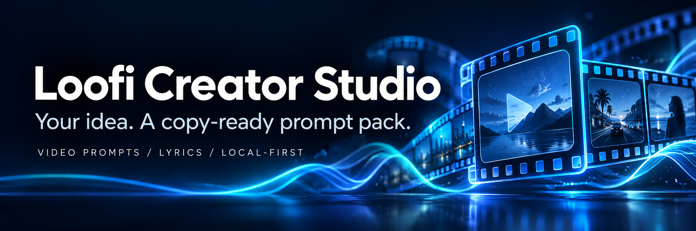
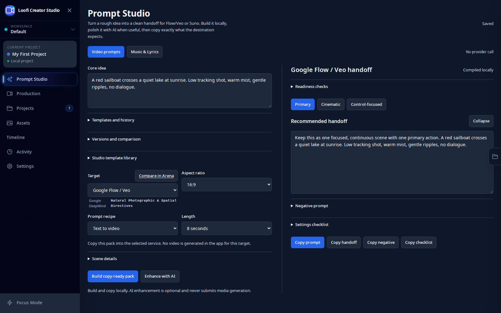
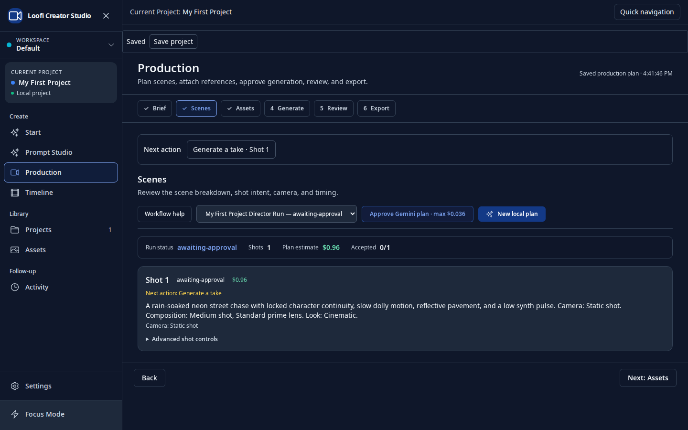
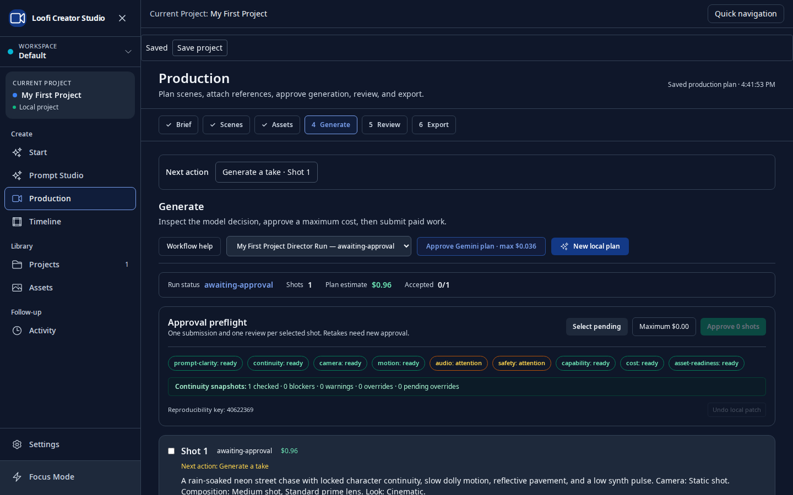
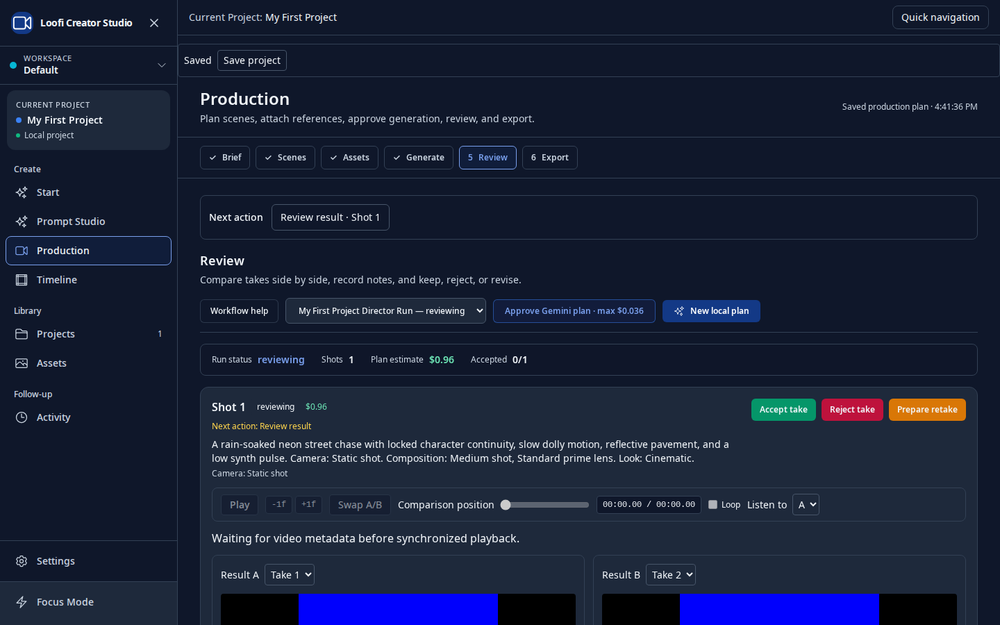

<p align="center">
  
</p>

# Loofi Creator Studio



<p align="center">
  <strong>Create a finished video from your own clips. Build video prompts and lyrics when you need them.</strong><br />
  A local-first desktop workspace for creators, with editable variants, model comparison and portable projects.
</p>

<p align="center">
  <a href="https://github.com/loofiboss-bit/Loofi-Veo-prompt-generator/releases/latest"><strong>Download</strong></a> ·
  <a href="docs/wiki/Home.md"><strong>Explore the wiki</strong></a> ·
  <a href="docs/wiki/Quick-Start.md"><strong>Quick start</strong></a> ·
  <a href="https://github.com/loofiboss-bit/Loofi-Veo-prompt-generator/issues">Report an issue</a>
</p>

[](https://github.com/loofiboss-bit/Loofi-Veo-prompt-generator/releases/latest)
[](https://github.com/loofiboss-bit/Loofi-Veo-prompt-generator/actions/workflows/validate.yml)
[%20%7C%20Windows%20(Optional)-3b82f6?style=flat-square&labelColor=0f172a>)](#install-v2200)
[](LICENSE)
[](https://github.com/loofiboss-bit/Loofi-Veo-prompt-generator/stargazers)
[](https://github.com/loofiboss-bit/Loofi-Veo-prompt-generator/forks)
[](https://github.com/loofiboss-bit/Loofi-Veo-prompt-generator/releases)

The download counter counts all release assets, including checksums and metadata; it is not a count
of unique users or installations.

## v22.0: AI Video Iteration & Creative Loop

Loofi Creator Studio v22.0 evolves the studio into an intelligent, coherent creative environment where creators can iterate, analyze, and refine generated videos using natural language instructions.

- **AI Video Iteration:** Natural language multi-turn video edits powered by Gemini Omni 1.1 Flash via the stateful Interactions API (`previous_interaction_id`), honoring all model limits (3–10s, 360p–4K, 16:9/9:16).
- **Smart Version Control:** Non-destructive version lineage (`v1`, `v2`, `v3`) with full instruction history, source media protection, and built-in side-by-side A/B comparison.
- **Intelligent Creative Assistant:** Voluntary, reviewable AI suggestions for camera composition, lighting & visual continuity, goal deviation detection, and tailored next-turn instructions.
- **Unified Creative Workflow:** Effortless 7-step cycle connecting Idea → Prompt Studio → Video Generation → AI Analysis → Version Comparison → Storyboard Timeline → Final Export.
- **Timeline Integration & Version Badges:** Seamless version transfer to Storyboard takes and clear timeline clip version indicators (`[v2]`, `[v3]`).
- **Fedora KDE/Wayland Performance:** Optimized memory management, low-CPU overhead, and CSS GPU-accelerated rendering, tailored for Linux creators.

## v21: Polish, Design Harmony & Production Trust

Loofi Creator Studio v21 introduces an intuitive guided delivery flow, unified media library protection, complete plugin worker sandboxing, and refined design consistency across the studio.

- **Guided 4-Step Delivery Pipeline:** A clear sequential export stepper (Check delivery → Review delivery → Export video → Save files) with real-time preflights, cancellation, and soft recommendations.
- **Unified Media Library & Deletion Guards:** Filter media by All, Video, Audio, Images, References, and Generated with live counts. Assets actively placed on timeline tracks or Production Bible profiles are protected from accidental deletion.
- **Plugin Sandbox Isolation:** External plugins run with strict process isolation inside dedicated Web Workers with zero dynamic code evaluation (`wasm-unsafe-eval` CSP).
- **Consolidated Save Status:** Top-bar status chip (`saved`, `saving`, `conflict`, `error`) with 1-click save, eliminating redundant intrusive banners.
- **Fast Project Shortcuts:** "Continue editing" button in the Projects hub automatically routes to your active timeline or studio.

## Capability Matrix

| Capability                                   |  Local (No Account / No Key)  |     Desktop App (Electron)      |     API Key Required     | Experimental (Labs) |
| :------------------------------------------- | :---------------------------: | :-----------------------------: | :----------------------: | :-----------------: |
| **Video & Music Prompt Compilation**         |        ✅ Full offline        |             ✅ Yes              |     ❌ Not required      |       ❌ Core       |
| **Local Timeline Editor & Multi-track**      |        ✅ Full offline        |             ✅ Yes              |     ❌ Not required      |       ❌ Core       |
| **SRT Subtitle Import & Sync**               |        ✅ Full offline        |             ✅ Yes              |     ❌ Not required      |       ❌ Core       |
| **H.264/AAC MP4 & Package Export**           | ✅ Local Canvas/MediaRecorder |     ✅ Native ffmpeg/canvas     |     ❌ Not required      |       ❌ Core       |
| **Arena 8-Target Comparison**                |        ✅ Full offline        |             ✅ Yes              |     ❌ Not required      |       ❌ Core       |
| **Production Bible & Continuity Profiles**   |  ✅ Local sha256 & IndexedDB  |             ✅ Yes              |     ❌ Not required      |       ❌ Core       |
| **Portable `.loofi-project` & OTIO Bundles** |        ✅ Full offline        |             ✅ Yes              |     ❌ Not required      |       ❌ Core       |
| **Local Whisper Audio Transcription**        |   ❌ (Needs Desktop model)    | ✅ Local model (after download) |       ❌ No cloud        |       ❌ Core       |
| **AI Prompt Improvement (Ollama)**           |   ✅ Local Ollama instance    |             ✅ Yes              |    ❌ Local endpoint     |     ❌ Optional     |
| **AI Prompt Improvement (Gemini)**           |         ❌ Cloud API          |             ✅ Yes              |    🔑 Gemini API Key     |     ❌ Optional     |
| **Veo API / Lyria Cloud Generation**         |         ❌ Cloud API          |             ✅ Yes              | 🔑 Google Cloud / Vertex |  🧪 Approval-gated  |
| **3D Camera Staging & Previz**               |        ✅ Full offline        |       ✅ WebGL / Three.js       |     ❌ Not required      |   🧪 Experimental   |
| **Sandboxed External Plugins**               |    ✅ Isolated Web Workers    |     ✅ Isolated Web Workers     |     ❌ Not required      |   🧪 Experimental   |

## Your clips to a finished video

Loofi Creator Studio v16 adds reliable local editing, atomic project document persistence, linked captions, and verified offline MP4 delivery up to three minutes.

1. On **Start**, choose **Create from your own clips** and select video, images or audio.
2. Arrange and trim clips in the local editor. Add captions or import SRT with Add/Replace.
3. Choose **Check delivery**, fix every reported issue, then **Review delivery**.
4. Export up to three minutes of verified H.264/AAC video and save MP4 or a publication ZIP.

Project autosave reports durable storage and backup failures separately. Conflicts preserve local
work with **Load latest** and **Save as copy**. Projects exposes search, sorting, archive and automatic
backup recovery. Native jobs survive navigation; rendering interrupted by app exit is marked failed.
Local media, editing and supported desktop export require no account, key or external request.

Start surfaces the active project's next action and known recovery needs. Expand examples or recipes
when needed. The timeline's source preview aids editing; **Open delivery review** reaches the rendered
preview for checking the final mix, transitions and captions. Caption suggestions flag overlaps,
lines over 42 grapheme clusters and reading speeds over 20 per second for optional manual review.

The delivery steps distinguish rendering from saving the selected output. A saved filename records a
successful save at that time; the file may subsequently have been moved or deleted. Earlier jobs are
labelled as previous deliveries when they cannot be matched to the current edit.

See [the v16 workflow and qualification boundaries](docs/CREATOR_V16.md).
Source-only stabilization and reproducible performance checks are documented in
[v16 stabilization](docs/V16_STABILIZATION.md).

## Why creators use it

| From your idea to…             | What you get                                                                          |
| ------------------------------ | ------------------------------------------------------------------------------------- |
| **A video prompt pack**        | One primary and two editable alternatives, with synchronized copy fields.             |
| **A model comparison**         | Compile the same brief for eight video targets in Arena before choosing your handoff. |
| **A Suno lyrics pack**         | Separate style and lyrics, section locks, and manual copy into Suno.                  |
| **A reusable workflow**        | Local templates, saved revisions, comparison and restore.                             |
| **A portable project**         | Export your project with referenced media, checksums and provenance.                  |
| **An approved production run** | Review supported Veo/Lyria requests and a maximum charge before submission.           |

Prompt compilation runs locally without a provider key. Optional AI enhancement requires Gemini
or Ollama. External generators have their own accounts, availability and pricing.

**Video targets:** Flow, Veo API, Kling, Runway, Sora, Luma, Wan and Hailuo.
**Music handoff:** Suno. Manual handoffs copy prompt text; they do not generate video in this app.

## Your first prompt in a minute

1. Open **Prompt Studio → Video** and describe the scene you want to create.
2. Choose a target, mode and duration; add references if needed.
3. Select **Build copy-ready pack**, review the three variants and edit the result.
4. Copy the pack into your chosen generator, or compare targets in **Arena**.

For music, switch to **Music & Lyrics**, build your pack and use **Copy Style** and **Copy Lyrics**
in Suno. Follow the [quick start](docs/wiki/Quick-Start.md) for the complete workflow.

## Inside Prompt Studio



_A real v14.1.0 browser capture with a fictional scene: local compilation, three variants,
revision tools and a ready-to-copy handoff. No provider key or generation request._

## Start here

| Goal                                              | Where to go                                               |
| ------------------------------------------------- | --------------------------------------------------------- |
| Build and edit video prompts                      | **Prompt Studio → Video** (`/studio`)                     |
| Prepare a Suno lyrics pack                        | **Prompt Studio → Music & Lyrics** (`/studio?mode=music`) |
| Create, open, import or export projects           | **Projects**                                              |
| Review and approve supported Veo/Lyria generation | **Production** (`/create`)                                |
| Configure an AI provider when needed              | **Settings**                                              |
| Inspect experimental capabilities                 | **Settings → Labs**                                       |
| Read the user guide                               | [docs/USER_GUIDE.md](docs/USER_GUIDE.md)                  |

The application ID remains `com.loofi.flowveostudio`. Existing local data and documented archive
schemas are preserved. Legacy routes `/director`, `/composer`, and `/optimize` redirect to `/create`.

## Prompt Studio

Start with an idea, select a target and choose **Create with Gemini**. One approved AI request
returns editable scene details and three target-tailored variants. The recommended variant opens
automatically. Manual details are preserved exactly; individual field protection controls let you
explicitly allow regeneration. **Undo AI creation** restores the saved pre-generation revision.
**Build copy-ready pack** remains the offline, zero-token alternative.

Expand **Scene details** for camera optics/composition, character consistency, environment, light,
style and sound. Existing creative presets fill empty fields. Saved characters supply Visual DNA
without replacing an authored subject. Regenerating one unlocked scene field leaves the other
fields unchanged and marks the existing output as outdated until rebuilt. Variant refinement can
make the selected prompt more cinematic, realistic, dynamic or detailed.

Wide workspaces show editor and result side by side; narrow workspaces use **Editor / Result**.
**Copy prompt** copies the selected version; **Copy options** exposes settings and the complete
handoff. **Templates and history** contains reusable templates, earlier packs and revisions.

Current manual handoffs cover Flow/Veo 3.1 Lite/Fast/Quality, Gemini Omni 1.1 Flash, Kling 4.0,
Runway Gen-4.5, Luma Ray3.2, Wan 3.0 and MiniMax-H3. Model profiles determine modes, duration,
aspect ratio, writing rules, audio and negative-prompt support. Unverified features are not treated
as supported; audio for non-audio targets stays in post-production notes. Wan's older open-weight
workflow remains an explicit legacy profile. See [the dated target reference](docs/PROMPT_STUDIO_TARGETS.md).

Sora and shut-down Gemini API Veo Preview bindings are unavailable for new generation. Existing
prompt text, history and exports remain readable. Choose an active target explicitly before
creating a replacement; no paid provider or target is silently substituted. Video-model services
with their own APIs still use manual handoff here unless an existing integration is qualified.

Music retains independent lyrics, section locks and editable variants. Suno v6/v6-wild (Pro or
Premier), v6-mini and existing saved profiles are available as manual handoffs. Expansion preserves
locked lyric sections. Concise style text is guidance rather than an undocumented 200-character
hard limit.

AI uses the existing Gemini/Ollama provider boundary, cancellation and cost approvals. A missing
key or invalid response preserves the draft and offers the local workflow. Late answers cannot
replace a newer project, idea or settings. Scene changes and generated output are saved together
before display; save failures retain the previous content. Model, style and language are saved
with the project. **Saving**, **Saved**, and **Not saved** reflect the persistence result.

## Release History & Foundations

For complete historical progression, see [Release notes](docs/wiki/Release-Notes.md) and [CHANGELOG.md](CHANGELOG.md).

- **v21.0:** Guided delivery, coordinated saves, media guards, recovery navigation and caption review.
- **v20.0:** Project-safe editing, field-level music/video AI improvement, local Whisper transcription, and cost locking.
- **v19.0:** Pro A/B take review, cinematic AST conflict linter, and multi-shot batch controls.
- **v16.0–v18.0:** Multi-track local editing, atomic document persistence, and verified offline MP4 delivery.

## Portable projects and production

Projects exposes creation, import and export directly. `.loofi-project` archives contain the chosen
project document, referenced local media, relative paths, checksums and provenance. Import assigns
consistent local IDs and revokes active cost approvals. Missing media blocks export instead of
producing an unusable archive.

Production retains its Brief → Scenes → Assets → Generate → Review → Export workflow. OTIO bundles
use actual timeline tracks, gaps, trims and selected takes with packaged media. FCPXML is experimental
until import into an external editor is qualified.

## Labs

Labs is off by default. Camera staging is a local preview experiment. ComfyUI diagnostics can be
opened after enabling Labs, but video rendering is unavailable. Live audio, LAN collaboration and
Foley generation have incomplete integrations and their actions are disabled. GPU rendering,
physical multi-device collaboration and external NLE imports are not qualified by mock tests.

See [v14 implementation notes](docs/V14_IMPLEMENTATION.md) for contracts and verification boundaries.

## Local-first safety

- Projects, prompt artifacts, history, settings, and media stay local by default.
- `PromptArtifactV1` keeps normalized input, one primary, two alternatives, validation, provenance,
  and byte-identical copy fields together.
- Gemini and Ollama optimization uses a structured JSON contract; invalid provider output leaves the
  local draft visible instead of silently falling back.
- Paid provider requests are fail-closed and require an explicit approval with a maximum charge.
- Desktop credentials stay in the operating-system vault and never enter renderer state.
- `.loofi-project` schema 11 and Creative Pack schema 5 preserve older project data and unknown fields.

## Install v22.0.0

Download the [v22.0.0 GitHub Release](https://github.com/loofiboss-bit/Loofi-Veo-prompt-generator/releases/tag/v22.0.0)
and verify the asset against `SHA256SUMS.txt` before installing.

### Fedora Linux (Primary Target — Fedora 44 & Fedora 45 x86_64)

The primary supported platform for Loofi Creator Studio is **Fedora Linux** (Fedora 44 and Fedora 45 on x86_64 / Wayland / KDE).

#### Fedora COPR (Recommended)

```bash
sudo dnf copr enable loofitheboss/loofi-creator-studio
sudo dnf install veo-prompt-generator
```

The [COPR project](https://copr.fedorainfracloud.org/coprs/loofitheboss/loofi-creator-studio/)
publishes verified packages for Fedora 44 and Fedora 45 x86_64. Package availability follows COPR metadata; run `sudo dnf upgrade veo-prompt-generator`
if an older package is already installed.

#### Fedora RPM from GitHub

```bash
sudo dnf install ./Loofi-Flow-Veo-Studio-22.0.0-linux-x86_64.rpm
```

#### Linux AppImage

```bash
chmod +x Loofi-Flow-Veo-Studio-22.0.0-linux-x86_64.AppImage
./Loofi-Flow-Veo-Studio-22.0.0-linux-x86_64.AppImage
```

### Windows (Optional / Manual Build Only)

Windows binaries are not built or published by automated CI. Loofi Creator Studio prioritizes native Fedora Linux RPM and AppImage workflows. Users who want Windows binaries can build them manually:

```bash
# On a Windows x64 machine:
npm ci
npm run build
npx electron-builder --win
```

Output binaries will be generated in `release/`:

- NSIS installer: `Loofi-Flow-Veo-Studio-22.0.0-win-x64-setup.exe`
- Portable executable: `Loofi-Flow-Veo-Studio-22.0.0-win-x64-portable.exe`

## Offline Video & Publication Guides

See the [local verification report and demonstration](docs/CREATOR_V15_VERIFICATION.md) for real rendered files, five AI-driven scenarios and platform qualification boundaries.

Creator Studio provides local recipes, reusable offline examples,
captions and a desktop video/publication-package export workflow:

- [Export your first offline video](docs/guides/FIRST_OFFLINE_VIDEO.md)
- [Add captions and your own style](docs/guides/CAPTIONS_AND_STYLE.md)
- [Prepare a publication package](docs/guides/PUBLICATION_PACKAGE.md)
- [Current delivery behavior and limits](docs/CREATOR_DELIVERY.md)

Local examples, editing, recipes and verified desktop export need no provider account or key.
Optional Gemini proposals require approval and may incur provider charges. Social publishing remains
a manual handoff.

## Development

The v14.2 creator flow connects manual Studio video results back to their
original prompt variants. Import a local video, confirm a manual review, and use it on a storyboard
scene and timeline. Production shows scene-specific next actions, recovery for known jobs, and
review sources and findings. Timeline and Production can export only the selected edit as an OTIO
delivery ZIP; complete `.loofi-project` backups remain separate and strict.

See [creator-flow contracts and verification](docs/CREATOR_FLOW.md). Qualified installers are published
through the tag workflow after package gates pass; public availability is shown on GitHub Releases.

Node.js 24 and npm are required.

```bash
nvm use
npm ci
npm run electron:dev
```

Useful checks:

```bash
npm run validate
npm run validate:release
npm run screenshots
```

## Documentation

- [Documentation portal](docs/README.md)
- [User guide](docs/USER_GUIDE.md)
- [Prompting guide](docs/wiki/Prompting-Guide.md)
- [Suno handoff](docs/wiki/Suno-Handoff.md)
- [Production workflow](docs/wiki/Production-Workflow.md)
- [Architecture](docs/ARCHITECTURE.md)
- [Roadmap](ROADMAP.md)
- [Release process and evidence](docs/RELEASE.md)
- [Installation and updates](docs/wiki/Installation-and-Updates.md)
- [Release notes](docs/wiki/Release-Notes.md)
- [Contributing](CONTRIBUTING.md)
- [Security policy](SECURITY.md)

## A look inside Production



_Production scene planning. These deterministic screenshots show the advanced workflow;
Prompt Studio is the copy-first starting point._

| Review before spending                                                          | Review your selected takes                                       |
| ------------------------------------------------------------------------------- | ---------------------------------------------------------------- |
|  |  |

The [screenshot guide](docs/wiki/Screenshots.md) explains how to regenerate the deterministic,
provider-free fixtures. The screenshots cover the advanced production workflow; Prompt Studio is the
copy-first entry point in the shipped application.

## Help shape the studio

Found a rough edge? [Report a bug](https://github.com/loofiboss-bit/Loofi-Veo-prompt-generator/issues/new/choose)
or suggest a workflow improvement. Contributions are welcome: start with
[CONTRIBUTING.md](CONTRIBUTING.md), the [architecture](docs/ARCHITECTURE.md) and the
[security policy](SECURITY.md). If the studio helps your workflow, a GitHub star helps others discover it.

MIT License — see [LICENSE](LICENSE). Independent project; not affiliated with Google or the other
model providers. Product names belong to their respective owners.
