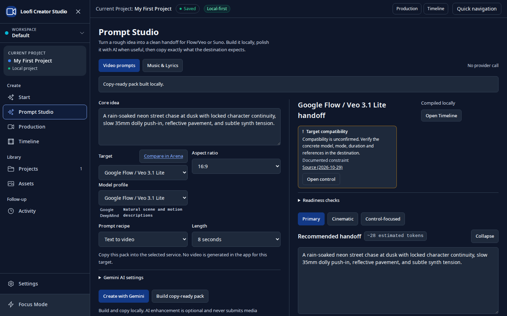
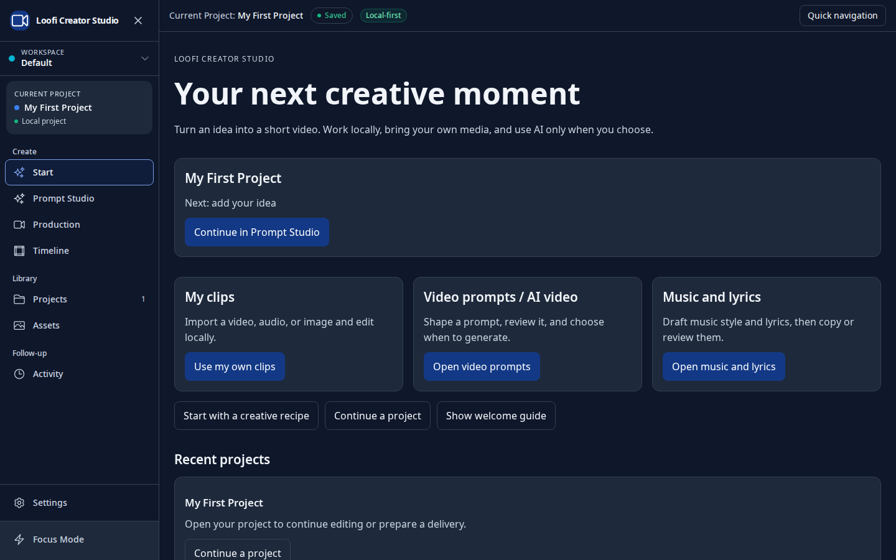
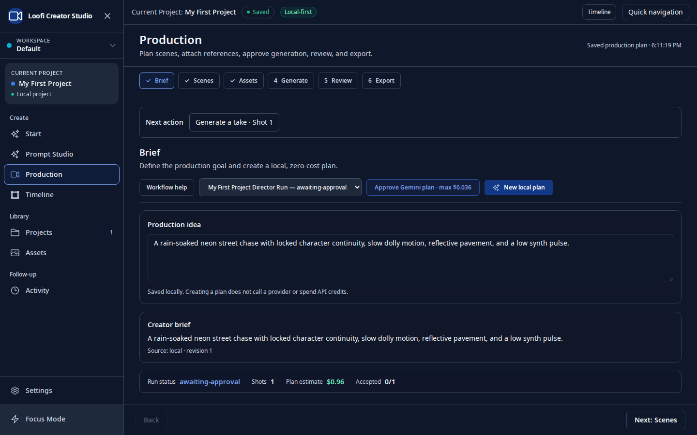
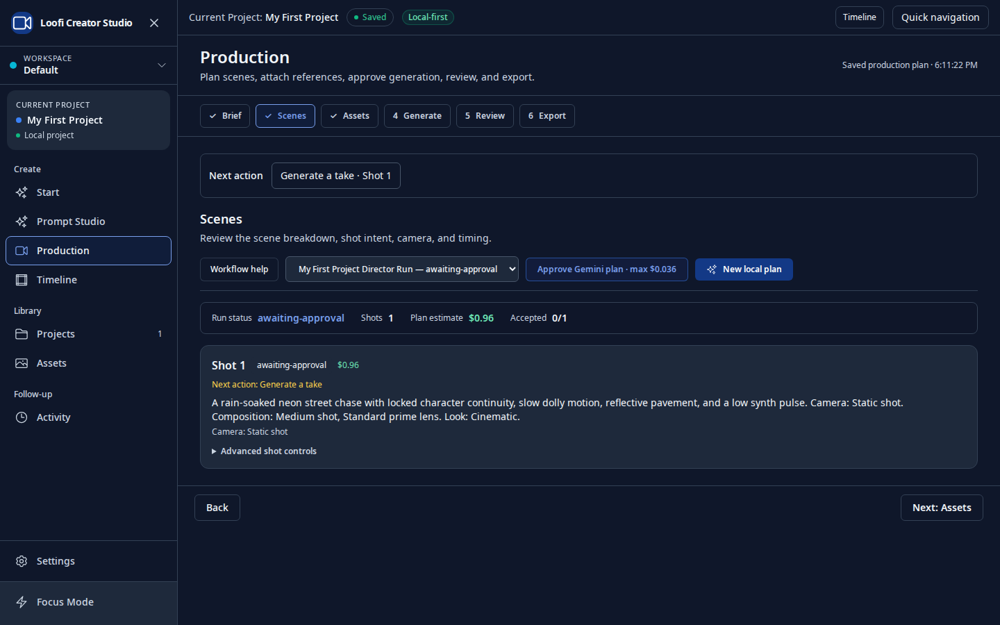
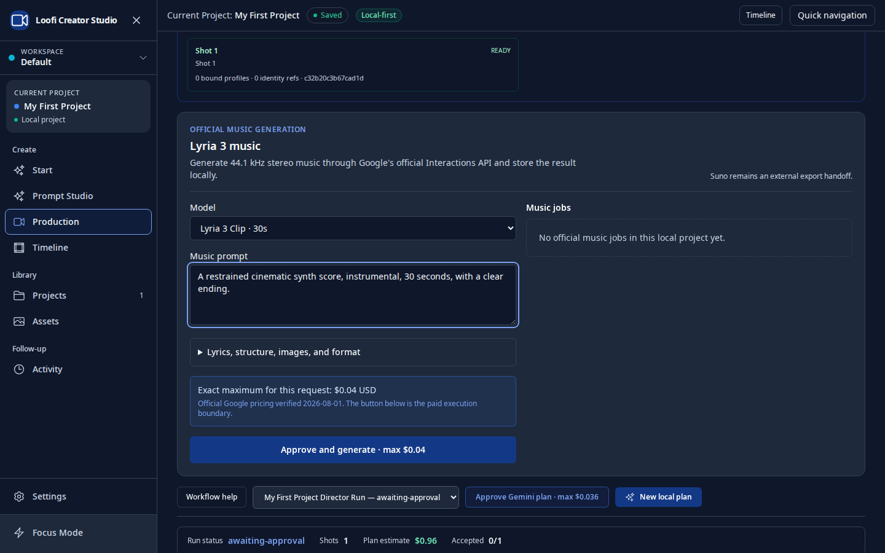
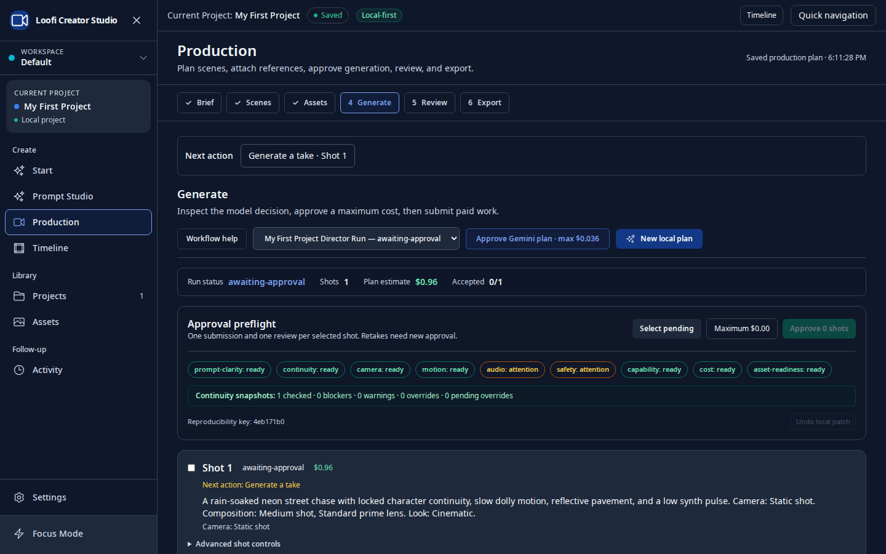
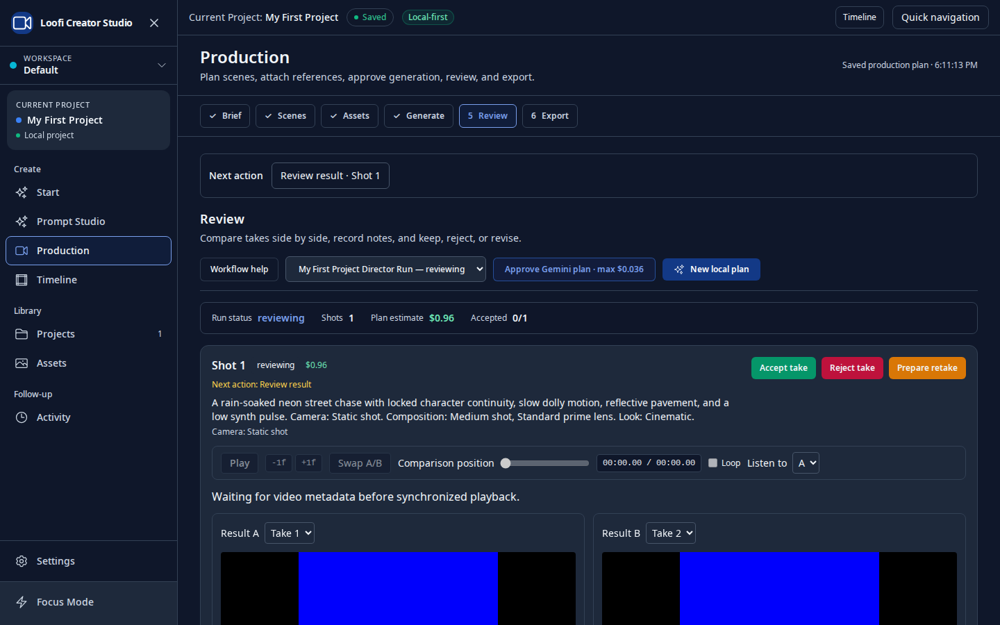
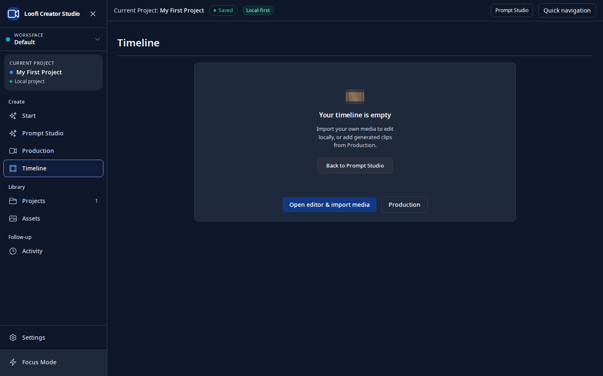
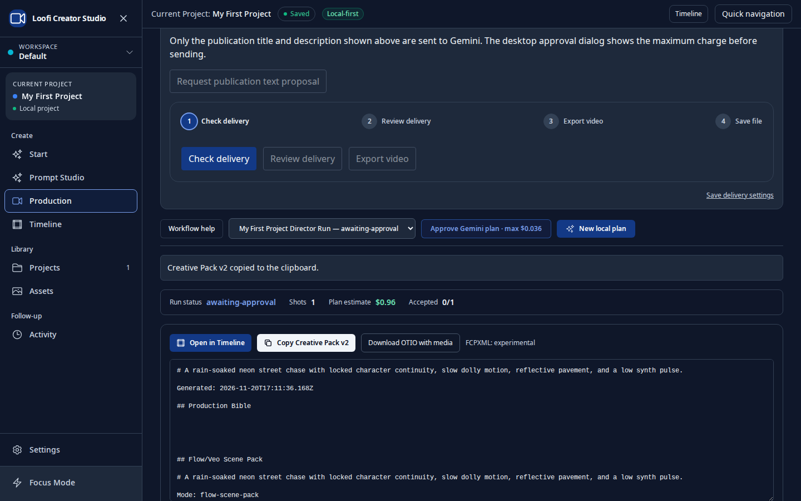
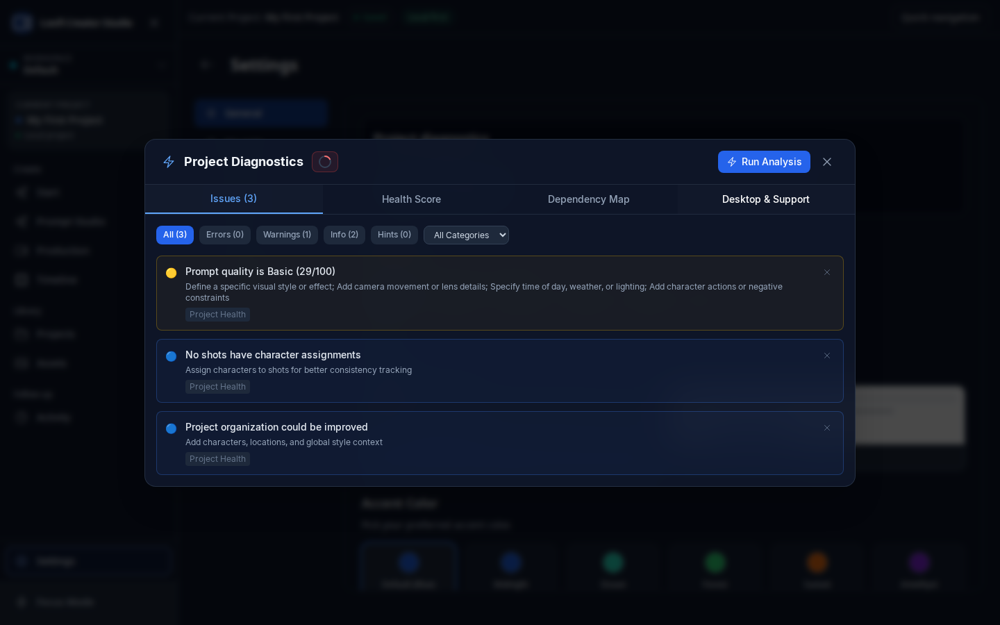

# Screenshots

## Prompt Studio & Start — v23.0.0



Deterministic v23.0.0 browser captures showing the unified **Workspace Context Rail**, local compilation, editable variants, revision tools, and ready-to-copy handoffs with no configured provider key.



## Production fixtures (v23.0.0)

These deterministic captures cover the Production workflow, Timeline, and Diagnostics using local fixtures and fake providers. They contain no provider credentials and make no paid calls.











Regenerate and verify all current screenshots (plus historical links in `assets/screenshots/README.md`) with:

```bash
npm run screenshots
```
